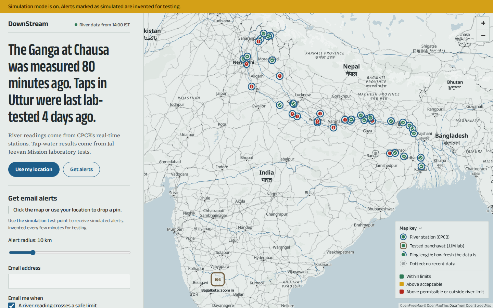
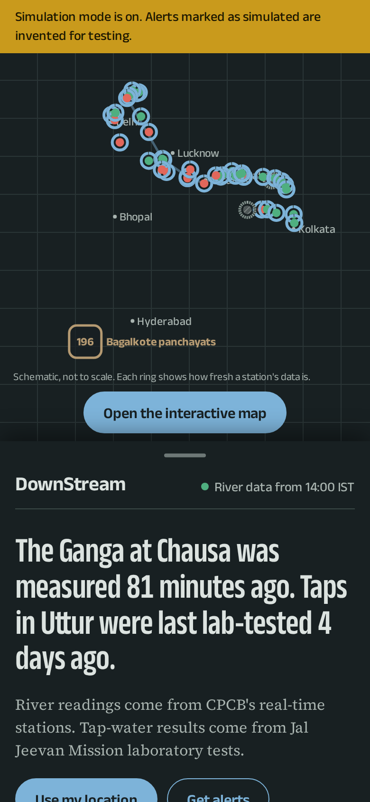
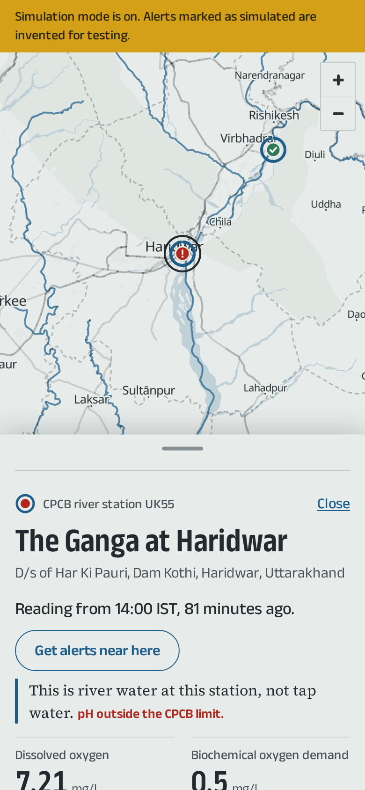
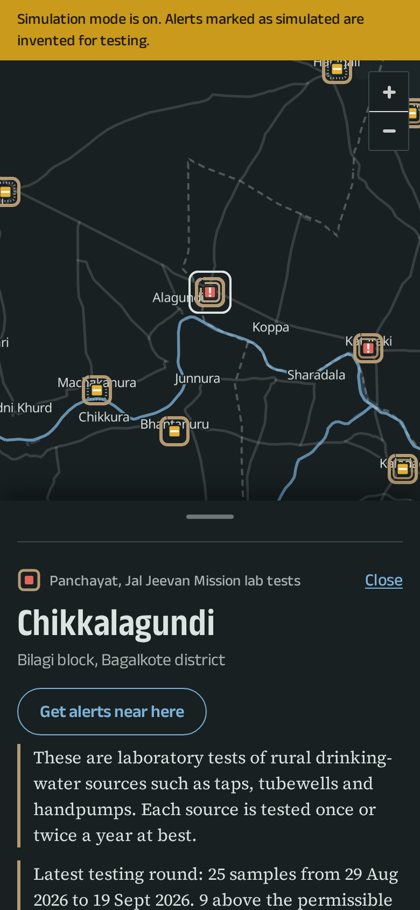

# DownStream

What India's government water data says about a place, how old that data is, and an email when something
new or worrying is published.

- **Rivers (fast):** CPCB's 40 real-time stations in the Ganga basin, read every 15 minutes, with every
  new reading kept.
- **Taps (slow):** Jal Jeevan Mission laboratory results (WQMIS) for rural drinking-water sources,
  covering Bagalkote district (196 panchayats, about 12,500 samples over two financial years).
- Both on one map, where every marker's ring shows how fresh its data is. You can ask "what's near me",
  subscribe to a pin and radius by email, and run a simulation mode that invents clearly labelled alerts
  for demos.



| Phone, night | Station panel | Lab-report rulers |
|---|---|---|
|  |  |  |

## Run it

Needs only Docker Desktop.

```sh
cp .env.example .env        # then set CONTACT_EMAIL; mail goes to Mailpit until you set a real SMTP_URL
docker compose up --build
```

| URL | What |
|---|---|
| http://localhost:5173 | The site (Vite dev server with hot reload) |
| http://localhost:8080 | The same site as production builds it: one Fastify process serving `/api` and the built frontend |
| http://localhost:8025 | Mailpit, the development inbox: all mail with the example settings, and mail to reserved test domains (`example.com`, `*.test`) when `SMTP_SINK_URL` points here |
| http://localhost:8081 | Adminer (server `db`, user, password and database `water`) |
| `localhost:5433` | Postgres + PostGIS for desktop SQL tools |

On first start the worker fills an empty database by itself:
1. The CPCB layer plus 7 days of history for every station (about 5 minutes).
2. The WQMIS hierarchy for the configured districts (about 2 minutes).
3. Panchayat locations from OpenStreetMap.
4. Sample lists (about 10 minutes).

Lab reports then trickle in at 500 an hour, contaminated samples first. `docker compose down` keeps the
data; `npm run db:reset` wipes it.

## Demo

1. Open http://localhost:5173. The hero sentence gives the age of the freshest river reading and of the
   latest tap test.
2. Zoom into the Ganga to see river rings, or click the Bagalkote marker for panchayats.
3. Choose a station for its 48-hour charts, or a panchayat for its lab-report rulers.
4. Under "Get email alerts", press **Use the simulation test point**, or type "testing" in the place
   search. Enter your email and press "Send confirmation email". With a real `SMTP_URL` (see
   docs/RENDER.md) the confirmation arrives in your inbox; with the example settings, in Mailpit. Open it
   and click the link.
5. Simulated alerts arrive every few minutes, marked `[Simulated]`.
6. Fire an urgent one now:

   ```sh
   curl -X POST "http://localhost:8080/api/dev/simulate?kind=tap_contamination"
   ```

   It arrives within a minute.

## Tests

```sh
npm test                                         # 60 unit + API tests (node:test, fixtures only, no network)
npm run test:integration                         # real Postgres + Mailpit: ingest, alerts, mailer, breaker, overrides
docker compose --profile e2e run --rm e2e        # 10 browser checks in Playwright against the production build
docker compose --profile e2e run --rm e2e shots  # regenerate docs/screenshots
docker compose --profile test run --rm test      # unit tests inside Docker, nothing on the host
```

The browser checks cover the following, among others:
- the live hero;
- a keyboard-only walkthrough, from the skip link through the list, a panel and subscribing;
- geolocation, and refused geolocation with place search;
- form errors;
- double opt-in → simulated urgent email within a minute → one-click unsubscribe, all through Mailpit's
  API;
- the phone bottom sheet;
- reduced motion;
- the freshness ledger.

## Run one job now

```sh
docker compose exec worker node services/worker/run-once.js <job>
# cpcb | wqmis-hierarchy | geocode | wqmis-samples | wqmis-reports | wqmis-dashboard | overdue | digest | mailer | simulator | bootstrap
```

## How it is built

```
web/               Vite, vanilla JS, MapLibre GL (OpenFreeMap tiles, recoloured), d3-scale/d3-shape, GSAP
services/api/      Fastify: /api/* plus the built frontend; runs migrations at boot (advisory lock)
services/worker/   the jobs: CPCB every 15 min, WQMIS daily/weekly, geocoding, alerts, mailer, digest, simulator
                   (node-cron locally; run-once.js from GitHub Actions in production)
packages/core/     parsers, AES, thresholds, alert logic, email templates, shared by api and worker
db/migrations/     plain SQL, applied in order
fixtures/          raw responses saved by scripts/probe/*; every parser test runs against these
docs/              SOURCES.md (what the sources really do), DESIGN.md, RENDER.md
```

Deployment costs nothing: Render's free web service and free Postgres (`render.yaml`), with every scheduled job
run by GitHub Actions in a public repository (`.github/workflows/`, one workflow per job calling
`services/worker/run-once.js`). Locally, the `worker` container still runs them all with node-cron.
See [docs/RENDER.md](docs/RENDER.md).

## Ground rules

- Every number carries its date, its source, and what kind of water it describes. River readings are
  "river water at this station", never "your water".
- Tap results show collected, analysed and first-seen-here dates. The gaps are information.
- Stale data stays on the map, marked stale.
- Nothing says water "is safe". The site makes no claim about water between official tests.
- Simulated alerts use invented places ("Test panchayat SIM-GP-1") and are always labelled. They never
  enter real statistics.
- Polite to government servers: at least 500 ms between requests per host, one request in flight,
  backoff, a circuit breaker after 5 failures, and a User-Agent with a contact email.
